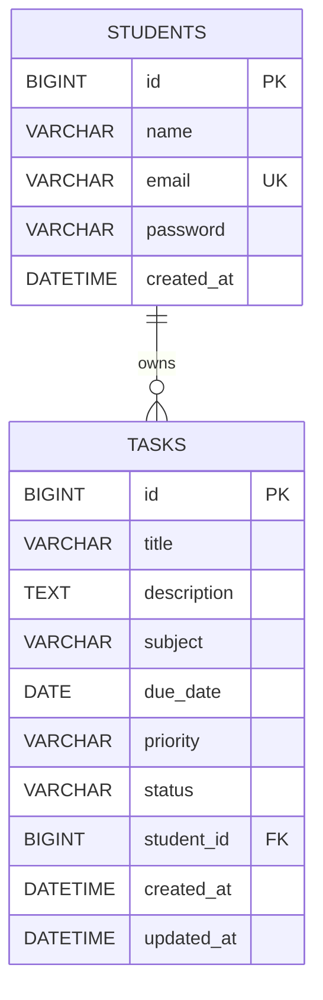

# Student Task Management System

StudyFlow is a beginner-friendly Spring Boot application for managing academic tasks. Students can register, sign in, create and update tasks, change status, search/filter their work, and see live dashboard statistics.

## Features

- Session-based login and registration with BCrypt passwords
- Per-student task ownership enforced in every service query
- Task CRUD, status updates, priority, deadline and subject
- Search by title/subject, status filters and overdue highlighting
- My Day view for overdue, today, and next-seven-day tasks
- Weekly productivity analytics with subject and status charts
- Combined subject filtering and due-date, priority, created-date, or title sorting
- Month calendar with priority indicators and date-specific task lists
- Separate overview dashboard and full My Tasks management page
- One-click CSRF-protected completion action for open tasks
- Detailed task view with description, badges, timestamps, editing, and completion
- Responsive Thymeleaf dashboard
- REST API under `/api`
- Bean Validation and centralized API error responses

## Technology and architecture

Java 17+, Spring Boot 3.4, Spring MVC, Spring Data JPA/Hibernate, Spring Security, Thymeleaf, MySQL 8, Maven. The request flow is:

```text
Browser / Postman -> Controller -> Service -> Repository -> JPA/Hibernate -> MySQL
                   <- view or JSON response <-
```

Packages are intentionally layered: `controller` handles HTTP, `service` contains business rules, `repository` contains persistence queries, `entity` models database tables, `dto` defines API/form shapes, `security` loads authenticated students, and `exception` formats errors.

## Database ER diagram



## Run locally on macOS

1. Install Java 17+ and Maven, then create the database:

   ```sql
   CREATE DATABASE student_task_manager;
   ```

   Or run [`database/schema.sql`](database/schema.sql) in MySQL Workbench.

2. Set credentials without committing them:

   ```bash
   export DB_USERNAME=root
   export DB_PASSWORD='your-local-mysql-password'
   ```

   `DB_URL` may be set if MySQL is not on `localhost:3306`.

3. Start the application:

   ```bash
   ./mvnw spring-boot:run   # if Maven Wrapper has been generated
   mvn spring-boot:run
   ```

4. Open http://localhost:8080/register. The application uses `spring.jpa.hibernate.ddl-auto=update` to create/update tables during local development.

## API endpoints

All task APIs require a logged-in session. Browser forms include CSRF tokens; for Postman, first log in while preserving the `JSESSIONID` cookie and include the CSRF token for state-changing requests.

| Method | Path | Purpose |
|---|---|---|
| POST | `/register` | Create an account |
| GET/POST | `/login` | Show/authenticate the login form |
| POST | `/logout` | Invalidate the session |
| GET | `/api/tasks?status=PENDING&search=math` | List owned tasks |
| GET | `/api/tasks/{id}` | Get one owned task |
| POST | `/api/tasks` | Create a task |
| PUT | `/api/tasks/{id}` | Replace task details |
| PATCH | `/api/tasks/{id}/status` | Change status |
| DELETE | `/api/tasks/{id}` | Delete an owned task |
| GET | `/api/dashboard/stats` | Get dynamic counts |
| GET | `/api/dashboard/my-day` | Get overdue, today, and upcoming tasks |
| GET | `/api/dashboard/analytics` | Get weekly and subject analytics |

Task listing accepts `status`, `search`, `subject`, and `sort` (`dueDate`, `priority`, `created`, or `title`) together.

The browser UI uses `/dashboard` for productivity overview and `/tasks` for the complete task table. `POST /tasks/{id}/complete` marks an owned pending or in-progress task completed, records `completed_at`, and redirects back with a success message.

Example JSON:

```json
{
  "title": "Revise algorithms",
  "description": "Review graph traversal notes",
  "subject": "Data Structures",
  "dueDate": "2030-05-20",
  "priority": "HIGH",
  "status": "PENDING"
}
```

## Testing

```bash
mvn test
```

The test profile uses an in-memory H2 database. `mvn package` creates an executable jar.

The `completed_at` column is added automatically by Hibernate for existing MySQL installations. It is populated when a task first transitions to `COMPLETED`; existing records are preserved.

Normal application execution uses MySQL from `application.properties` and the `DB_URL`, `DB_USERNAME`, and `DB_PASSWORD` environment variables. H2 is test-scoped only and is configured in `src/test/resources/application.properties`; it is not the normal application database.

## Enhancements

The dashboard's My Day cards use student-scoped date-range queries: overdue is strictly before today, due today is exactly today, and upcoming is tomorrow through seven days from today. Completed tasks are excluded from all three groups. Analytics uses completion timestamps for the current Monday-Sunday week, while the calendar queries all tasks in the selected month and filters a selected date server-side.

## Verification checklist

- [ ] Register a new account and confirm a duplicate email is rejected.
- [ ] Sign in, sign out, and verify `/dashboard` redirects to login when unauthenticated.
- [ ] Create tasks with each priority/status and verify dashboard counts.
- [ ] Search by title and subject; filter by each status.
- [ ] Edit, complete, and delete a task; verify confirmation before deletion.
- [ ] Register a second account and verify it cannot read, update, or delete the first account's task.
- [ ] Try an invalid email, missing title, and past due date and confirm validation messages.

## Interview preparation guide

### Request lifecycle

Registration is handled by `AuthController`, validated by Bean Validation, and passed to `StudentService`, which checks the unique email and hashes the password with BCrypt before `StudentRepository.save`. Login is handled by Spring Security's form filter; `CustomUserDetailsService` loads the email and BCrypt hash. An authenticated dashboard request reaches `PageController`, obtains the current student from the session identity, asks `TaskService` for owned tasks and statistics, then renders Thymeleaf. API requests follow the same service path and serialize DTOs as JSON.

### Important design decisions

1. Controllers translate HTTP; they do not contain database logic.
2. Services enforce ownership and business defaults.
3. Repositories use `studentId` in every task lookup.
4. JPA maps `Student` one-to-many to `Task`; the foreign key is on `tasks.student_id`.
5. DTOs prevent entity internals and password data from being exposed.
6. `TaskStatus` and `Priority` enums prevent invalid values.
7. BCrypt is one-way and intentionally salts each password.
8. Sessions are simpler than JWT for this server-rendered application.
9. CSRF remains enabled for browser forms.
10. Dynamic counts use database count queries, not hardcoded values.

### 30 interview questions and short answers

1. **Why Spring Boot?** It provides auto-configuration, embedded-server support, and production conventions.
2. **Why layered architecture?** Each layer has one responsibility and is easier to test.
3. **What does dependency injection do?** Spring creates collaborators and supplies them through constructors.
4. **What is a controller?** The HTTP boundary that accepts requests and returns views or responses.
5. **What is a service?** The business-rule boundary used by both MVC and REST controllers.
6. **What is a repository?** A typed persistence abstraction generated by Spring Data.
7. **What is JPA?** A Java standard for mapping objects to relational data.
8. **What is Hibernate?** The JPA implementation executing SQL and tracking entity changes.
9. **Why `@ManyToOne` on Task?** Many tasks can belong to one student.
10. **Where is ownership enforced?** `findByIdAndStudentId` is used by every task mutation/read.
11. **Why use DTOs?** To control input/output and avoid exposing entities or passwords.
12. **How is a duplicate email prevented?** A service check plus a database unique constraint.
13. **How are passwords stored?** BCrypt hashes are stored; plaintext is never persisted.
14. **How does login identify a student?** The submitted email is the Spring Security username.
15. **Why sessions?** They fit a server-rendered Thymeleaf application without token plumbing.
16. **What does CSRF prevent?** Forged browser state-changing requests from another site.
17. **What does `@Valid` do?** It runs the declared DTO constraints before service logic.
18. **How are invalid API inputs returned?** `GlobalExceptionHandler` maps validation failures to 400 JSON.
19. **Why use enums?** They constrain priority and status to known values.
20. **How are overdue tasks detected?** A response DTO compares due date with today unless completed.
21. **How does search work?** A parameterized JPQL query matches title or subject for the owner.
22. **How are tasks sorted?** The repository orders by ascending due date.
23. **What is a transaction?** A unit of work that commits all persistence changes together.
24. **Why `readOnly=true` for reads?** It communicates intent and can reduce persistence overhead.
25. **What is `orphanRemoval`?** Removing a child from its parent relationship removes its row.
26. **Why `FetchType.LAZY`?** Student data is not loaded unnecessarily with every task.
27. **How does dashboard data stay current?** Counts are queried from the database per request.
28. **How would you add pagination?** Accept `Pageable` in the repository and return a `Page<TaskResponse>`.
29. **How would you deploy?** Set environment variables, build the jar, and run it behind HTTPS.
30. **What would you improve next?** Pagination, email verification, reminders, and integration tests with Testcontainers.

## Future enhancements

Pagination, calendar view, reminders, attachment storage, email verification, password reset, and deployment monitoring can be added without changing the core service boundaries.
